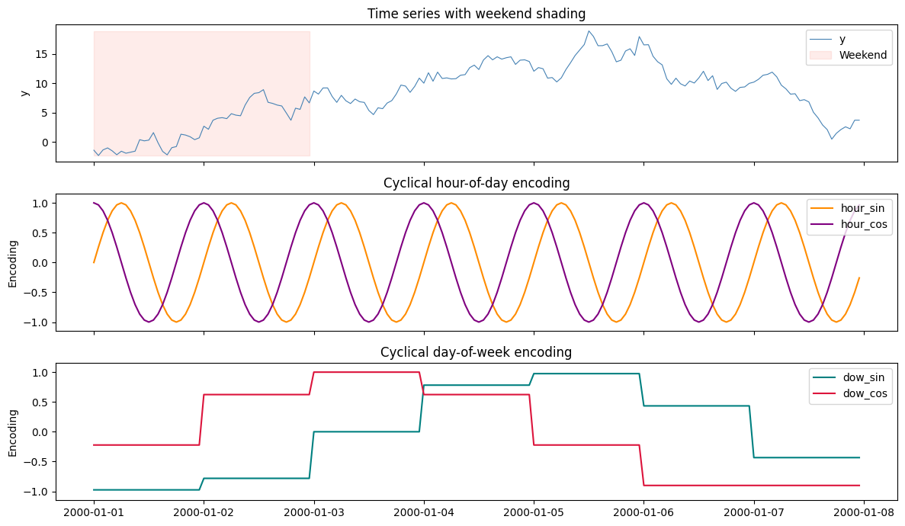
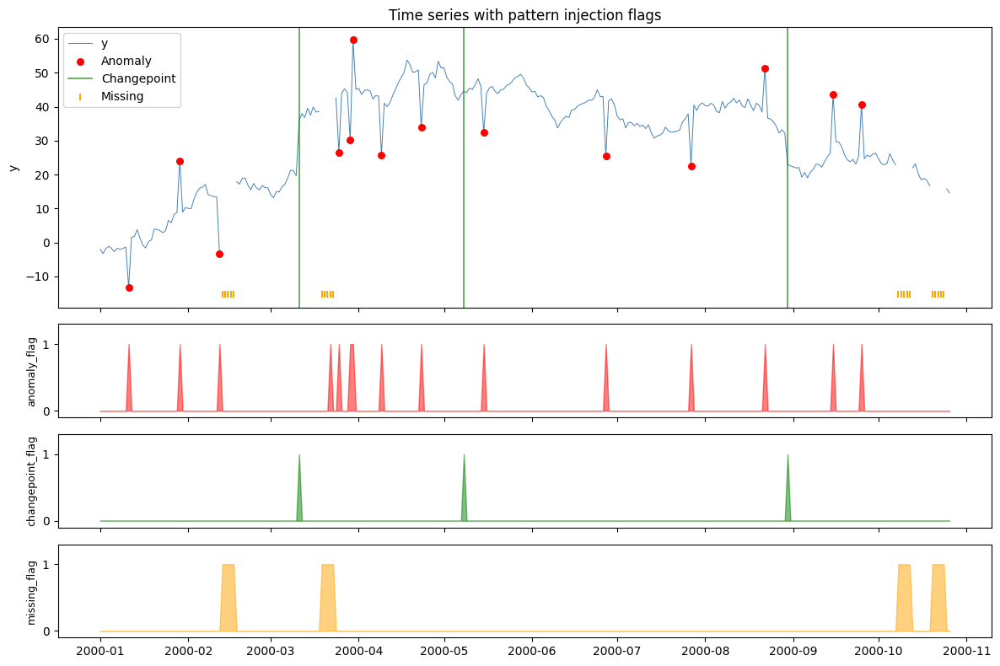

Every SynForecast generator can attach two kinds of extra columns, both
reproducible from the seed:

> **Two kinds of extra column**
>
> 1.  **Calendar features** (`calendar_features=CalendarFeatures(...)`):
>     calendar and cyclical (sin/cos) time encodings, added
>     frequency-aware. They are functions of the timestamps, so they are
>     known for every future period and are legitimate known-future
>     model inputs.
> 2.  **Diagnostic labels** (`diagnostics=DiagnosticsConfig(...)`):
>     binary `anomaly_flag` / `changepoint_flag` / `missing_flag`
>     columns marking exactly where each injected pattern landed. They
>     are ground truth for evaluating detectors, not model inputs: a
>     realized anomaly or break is not known at the forecast origin.

> **Covariates that drive the target**
>
> For covariates that *cause* the target, with known-future and
> past-only roles, distractors and the true relation recorded per group,
> use [covariate groups](./groups.html).

```python
import matplotlib.pyplot as plt
import numpy as np
import polars as pl

from synforecast.generators import RandomWalkGenerator
from synforecast import (
    Anomalies,
    CalendarFeatures,
    Changepoints,
    DiagnosticsConfig,
    Missing,
    OverlayConfig,
)

```

## Calendar features

`CalendarFeatures(basic=True)` adds calendar columns (year, month,
day_of_week, hour, etc.) and `cyclical=True` adds sin/cos encodings.
Features are frequency-aware: hourly data includes `hour`,
`hour_sin/cos`; daily data omits them since they would be constant.

```python
gen = RandomWalkGenerator(engine="polars", **{
    "min_length": 168,  # 7 days of hourly data
    "max_length": 168,
    "freq": "h",
    "seed": 42,
    "calendar_features": CalendarFeatures(cyclical=True),
})
df = gen.generate(n_series=1)

print(f"Columns: {df.columns}")
df.head(10)
```

```shell
Columns: ['unique_id', 'ds', 'y', 'year', 'quarter', 'month', 'day_of_year', 'day_of_week', 'day_of_month', 'is_weekend', 'hour', 'hour_sin', 'hour_cos', 'dow_sin', 'dow_cos', 'month_sin', 'month_cos', 'doy_sin', 'doy_cos']
```

| unique_id | ds                  | y         | year | quarter | month | day_of_year | day_of_week | day_of_month | is_weekend | hour | hour_sin | hour_cos   | dow_sin   | dow_cos   | month_sin | month_cos | doy_sin | doy_cos |
|-----------|---------------------|-----------|------|---------|-------|-------------|-------------|--------------|------------|------|----------|------------|-----------|-----------|-----------|-----------|---------|---------|
| cat       | datetime\[ns\]      | f64       | i32  | i8      | i8    | i16         | i8          | i8           | i8         | i8   | f32      | f32        | f32       | f32       | f32       | f32       | f32     | f32     |
| "0"       | 2000-01-01 00:00:00 | -1.401594 | 2000 | 1       | 1     | 1           | 5           | 1            | 1          | 0    | 0.0      | 1.0        | -0.974928 | -0.222521 | 0.0       | 1.0       | 0.0     | 1.0     |
| "0"       | 2000-01-01 01:00:00 | -2.307539 | 2000 | 1       | 1     | 1           | 5           | 1            | 1          | 1    | 0.258819 | 0.965926   | -0.974928 | -0.222521 | 0.0       | 1.0       | 0.0     | 1.0     |
| "0"       | 2000-01-01 02:00:00 | -1.352484 | 2000 | 1       | 1     | 1           | 5           | 1            | 1          | 2    | 0.5      | 0.866025   | -0.974928 | -0.222521 | 0.0       | 1.0       | 0.0     | 1.0     |
| "0"       | 2000-01-01 03:00:00 | -1.011828 | 2000 | 1       | 1     | 1           | 5           | 1            | 1          | 3    | 0.707107 | 0.707107   | -0.974928 | -0.222521 | 0.0       | 1.0       | 0.0     | 1.0     |
| "0"       | 2000-01-01 04:00:00 | -1.511372 | 2000 | 1       | 1     | 1           | 5           | 1            | 1          | 4    | 0.866025 | 0.5        | -0.974928 | -0.222521 | 0.0       | 1.0       | 0.0     | 1.0     |
| "0"       | 2000-01-01 05:00:00 | -2.176202 | 2000 | 1       | 1     | 1           | 5           | 1            | 1          | 5    | 0.965926 | 0.258819   | -0.974928 | -0.222521 | 0.0       | 1.0       | 0.0     | 1.0     |
| "0"       | 2000-01-01 06:00:00 | -1.574639 | 2000 | 1       | 1     | 1           | 5           | 1            | 1          | 6    | 1.0      | 6.1232e-17 | -0.974928 | -0.222521 | 0.0       | 1.0       | 0.0     | 1.0     |
| "0"       | 2000-01-01 07:00:00 | -1.915517 | 2000 | 1       | 1     | 1           | 5           | 1            | 1          | 7    | 0.965926 | -0.258819  | -0.974928 | -0.222521 | 0.0       | 1.0       | 0.0     | 1.0     |
| "0"       | 2000-01-01 08:00:00 | -1.746987 | 2000 | 1       | 1     | 1           | 5           | 1            | 1          | 8    | 0.866025 | -0.5       | -0.974928 | -0.222521 | 0.0       | 1.0       | 0.0     | 1.0     |
| "0"       | 2000-01-01 09:00:00 | -1.566314 | 2000 | 1       | 1     | 1           | 5           | 1            | 1          | 9    | 0.707107 | -0.707107  | -0.974928 | -0.222521 | 0.0       | 1.0       | 0.0     | 1.0     |

```python
ts = df["ds"].to_list()
y = df["y"].to_numpy()
is_weekend = df["is_weekend"].to_numpy().astype(bool)

fig, axes = plt.subplots(3, 1, figsize=(12, 7), sharex=True)

# Panel 1: time series with weekend shading
axes[0].plot(ts, y, linewidth=0.8, color="steelblue", label="y")
axes[0].fill_between(ts, y.min(), y.max(), where=is_weekend,
                      alpha=0.15, color="salmon", label="Weekend")
axes[0].set_ylabel("y")
axes[0].set_title("Time series with weekend shading")
axes[0].legend(loc="upper right")

# Panel 2: hour-of-day cyclical encoding
axes[1].plot(ts, df["hour_sin"].to_numpy(), label="hour_sin", color="darkorange")
axes[1].plot(ts, df["hour_cos"].to_numpy(), label="hour_cos", color="purple")
axes[1].set_ylabel("Encoding")
axes[1].set_title("Cyclical hour-of-day encoding")
axes[1].legend(loc="upper right")
axes[1].set_ylim(-1.15, 1.15)

# Panel 3: day-of-week cyclical encoding
axes[2].plot(ts, df["dow_sin"].to_numpy(), label="dow_sin", color="teal")
axes[2].plot(ts, df["dow_cos"].to_numpy(), label="dow_cos", color="crimson")
axes[2].set_ylabel("Encoding")
axes[2].set_title("Cyclical day-of-week encoding")
axes[2].legend(loc="upper right")
axes[2].set_ylim(-1.15, 1.15)

plt.tight_layout()
plt.show()
```



## Diagnostic labels

When overlays inject anomalies, changepoints or missing data,
`DiagnosticsConfig` adds binary label columns marking exactly where each
pattern was injected. Use them to evaluate anomaly or changepoint
detectors; keep them out of a forecaster’s inputs.

```python
gen = RandomWalkGenerator(engine="polars", **{
    "min_length": 300,
    "max_length": 300,
    "freq": "D",
    "seed": 42,
    "drift": 0.1,
    "volatility": 1.5,
    "overlays": OverlayConfig(
        changepoints=Changepoints(count=3, kind="level"),
        anomalies=Anomalies(
            types=["spike", "dip"],
            fraction=0.05,
            spike_magnitude=15.0,
            dip_magnitude=-15.0,
        ),
        missing=Missing(pattern="block", rate=0.08, block_size=5),
    ),
    "diagnostics": DiagnosticsConfig(anomalies=True, changepoints=True, missing=True),
})
df = gen.generate(n_series=1)

print(f"Columns: {df.columns}")
print(f"Anomalies: {df['anomaly_flag'].sum()}, "
      f"Changepoints: {df['changepoint_flag'].sum()}, "
      f"Missing: {df['missing_flag'].sum()}")
df.head(10)
```

```shell
Columns: ['unique_id', 'ds', 'y', 'anomaly_flag', 'changepoint_flag', 'missing_flag']
Anomalies: 15, Changepoints: 3, Missing: 20
```

| unique_id | ds                  | y         | anomaly_flag | changepoint_flag | missing_flag |
|-----------|---------------------|-----------|--------------|------------------|--------------|
| cat       | datetime\[ns\]      | f64       | i8           | i8               | i8           |
| "0"       | 2000-01-01 00:00:00 | -2.002391 | 0            | 0                | 0            |
| "0"       | 2000-01-02 00:00:00 | -3.261309 | 0            | 0                | 0            |
| "0"       | 2000-01-03 00:00:00 | -1.728725 | 0            | 0                | 0            |
| "0"       | 2000-01-04 00:00:00 | -1.117742 | 0            | 0                | 0            |
| "0"       | 2000-01-05 00:00:00 | -1.767059 | 0            | 0                | 0            |
| "0"       | 2000-01-06 00:00:00 | -2.664304 | 0            | 0                | 0            |
| "0"       | 2000-01-07 00:00:00 | -1.661958 | 0            | 0                | 0            |
| "0"       | 2000-01-08 00:00:00 | -2.073275 | 0            | 0                | 0            |
| "0"       | 2000-01-09 00:00:00 | -1.72048  | 0            | 0                | 0            |
| "0"       | 2000-01-10 00:00:00 | -1.34947  | 0            | 0                | 0            |

```python
ts = df["ds"].to_list()
y = df["y"].to_numpy()
anom = df["anomaly_flag"].to_numpy().astype(bool)
cp = df["changepoint_flag"].to_numpy().astype(bool)
miss = df["missing_flag"].to_numpy().astype(bool)

fig, axes = plt.subplots(4, 1, figsize=(12, 8), sharex=True,
                          gridspec_kw={"height_ratios": [3, 1, 1, 1]})

# Panel 1: time series with flagged points
axes[0].plot(ts, y, linewidth=0.7, color="steelblue", label="y", zorder=1)
if anom.any():
    axes[0].scatter([ts[i] for i in range(len(ts)) if anom[i]],
                    y[anom], color="red", s=30, zorder=3, label="Anomaly")
if cp.any():
    for i, t_cp in enumerate([ts[i] for i in range(len(ts)) if cp[i]]):
        axes[0].axvline(t_cp, color="green", linewidth=1.2, alpha=0.7,
                        label="Changepoint" if i == 0 else None)
if miss.any():
    axes[0].scatter([ts[i] for i in range(len(ts)) if miss[i]],
                    np.full(miss.sum(), np.nanmin(y) - 2),
                    marker="|", color="orange", s=40, zorder=2, label="Missing")
axes[0].set_ylabel("y")
axes[0].set_title("Time series with diagnostic labels")
axes[0].legend(loc="upper left")

# Panels 2-4: binary flag traces
for ax, (name, flag, color) in zip(
    axes[1:],
    [("anomaly_flag", anom, "red"),
     ("changepoint_flag", cp, "green"),
     ("missing_flag", miss, "orange")],
):
    ax.fill_between(ts, 0, flag.astype(int), color=color, alpha=0.5)
    ax.set_ylabel(name, fontsize=9)
    ax.set_ylim(-0.1, 1.3)
    ax.set_yticks([0, 1])

plt.tight_layout()
plt.show()
```



## Combined

Calendar features and labels combine freely in a single generator call.

```python
gen = RandomWalkGenerator(engine="polars", **{
    "min_length": 200,
    "max_length": 200,
    "freq": "h",
    "seed": 42,
    "drift": 0.02,
    "volatility": 1.0,
    "overlays": OverlayConfig(
        changepoints=Changepoints(count=2),
        anomalies=Anomalies(fraction=0.04, spike_magnitude=12.0, dip_magnitude=-12.0),
        missing=Missing(rate=0.05),
    ),
    "calendar_features": CalendarFeatures(cyclical=True),
    "diagnostics": DiagnosticsConfig(anomalies=True, changepoints=True, missing=True),
})
df = gen.generate(n_series=1)

print(f"Generated DataFrame: {df.shape[0]} rows x {df.shape[1]} columns")
print(f"Columns: {df.columns}")
df.head(10)

```


```python
ts = df["ds"].to_list()
y = df["y"].to_numpy()
anom = df["anomaly_flag"].to_numpy().astype(bool)
cp = df["changepoint_flag"].to_numpy().astype(bool)
miss = df["missing_flag"].to_numpy().astype(bool)

fig, axes = plt.subplots(3, 1, figsize=(12, 8), sharex=True,
                          gridspec_kw={"height_ratios": [3, 1.5, 1]})

# Panel 1: main series + anomaly/changepoint markers
ax = axes[0]
ax.plot(ts, y, linewidth=0.7, color="steelblue", label="y")
if anom.any():
    ax.scatter([ts[i] for i in range(len(ts)) if anom[i]],
              y[anom], color="red", s=25, zorder=3, label="Anomaly")
if cp.any():
    for i, t_cp in enumerate([ts[i] for i in range(len(ts)) if cp[i]]):
        ax.axvline(t_cp, color="green", linewidth=1, alpha=0.6,
                   label="Changepoint" if i == 0 else None)
ax.set_ylabel("y")
ax.set_title("Series with diagnostic labels")
ax.legend(loc="upper left", fontsize=8)

# Panel 2: cyclical hour encoding
ax = axes[1]
ax.plot(ts, df["hour_sin"].to_numpy(), linewidth=0.8,
        color="darkorange", label="hour_sin")
ax.plot(ts, df["hour_cos"].to_numpy(), linewidth=0.8,
        color="purple", label="hour_cos")
ax.set_ylabel("Encoding")
ax.set_ylim(-1.15, 1.15)
ax.set_title("Cyclical hour encoding")
ax.legend(loc="upper right", fontsize=8)

# Panel 3: combined labels
ax = axes[2]
ax.fill_between(ts, 0, anom.astype(int) * 0.9 + 2.0,
                color="red", alpha=0.5, label="anomaly")
ax.fill_between(ts, 0, cp.astype(int) * 0.9 + 1.0,
                color="green", alpha=0.5, label="changepoint")
ax.fill_between(ts, 0, miss.astype(int) * 0.9,
                color="orange", alpha=0.5, label="missing")
ax.set_ylabel("Labels")
ax.set_yticks([0.45, 1.45, 2.45])
ax.set_yticklabels(["missing", "changepoint", "anomaly"], fontsize=8)
ax.set_ylim(-0.1, 3.2)
ax.set_title("Diagnostic labels")

plt.tight_layout()
plt.show()

```

