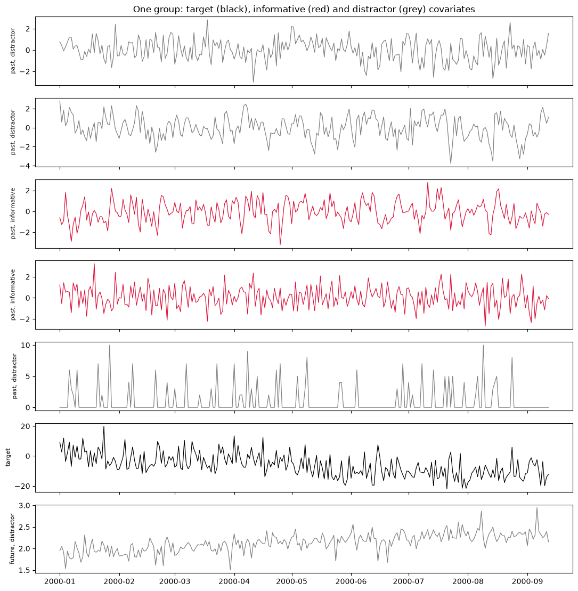
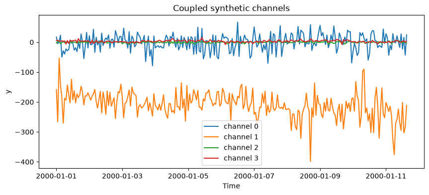
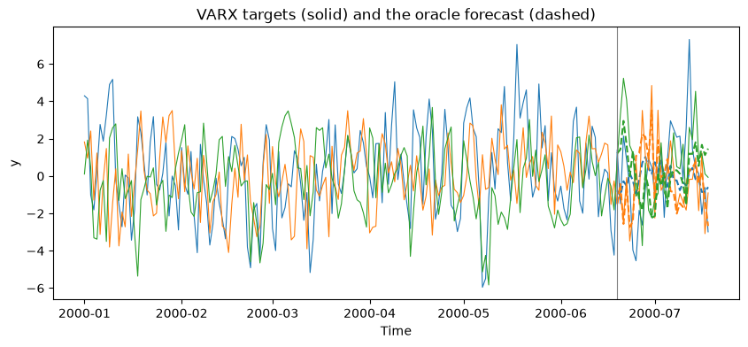

Forecasting models that take covariates must learn which inputs carry
information, at which lag, and whether a covariate is known for the
forecast periods. `GroupPrior` samples *groups* of aligned channels for
exactly that: every channel is a target or a covariate, every covariate
is either known in the future (`"future"`) or observed only up to the
forecast origin (`"past"`), and the ground truth of each group comes
back as a recipe.

> **Four mechanisms**
>
> -   **`RegressionSpec`**: one target caused by sampled covariates
>     through a random structural regression (lags, nonlinear edges,
>     interactions, distributed lags), plus distractors drawn from the
>     same generator pool.
> -   **`FixedRegressionSpec`**: an explicit regression, used by the
>     covariate-extraction probes.
> -   **`CoupledSpec`**: related channels from one base generator,
>     coupled by mixing and lead-lag (a Chronos-2-style
>     multivariatizer).
> -   **`VARXSpec`**: a linear VAR panel of targets driven by
>     regressors, with an oracle forecast.

Everything is causal: a discarded burn-in window absorbs lags and
filters and fixes all scaling, so no future value shapes the past.

```python
import matplotlib.pyplot as plt
import numpy as np

from synforecast import (
    CoupledSpec,
    GeneratorSpec,
    GroupPrior,
    RegressionSpec,
    RoleSpec,
    VARXSpec,
    VARXTruth,
    probe_suite,
)
from synforecast.generators import TSIGenerator

```

## A covariate regression prior

The default `RegressionSpec` draws one to six covariates per group, one
to three of them informative, and makes 15% of groups null (every
covariate a distractor). `RoleSpec` assigns roles independently of
informativeness, and channels are shuffled, so neither role nor position
gives the answer away.

```python
prior = GroupPrior(
    mechanism=RegressionSpec(),
    roles=RoleSpec(p_known_future=0.5),
    length=(256, 256),
    freq="D",
)
batch = prior.sample(n_groups=8, seed=0)
print(batch.diagnostics)
df = batch.to_long(engine="polars")
df.head()

```

```shell
{'n_groups': 8, 'n_null': 0, 'n_redrawn': 0, 'n_fallback': 0, 'n_controls': 0}
```

| group_id | unique_id | ds                  | y         | role   |
|----------|-----------|---------------------|-----------|--------|
| i64      | str       | datetime\[ns\]      | f64       | str    |
| 0        | "0_0"     | 2000-01-01 00:00:00 | 0.781472  | "past" |
| 0        | "0_0"     | 2000-01-02 00:00:00 | 0.420626  | "past" |
| 0        | "0_0"     | 2000-01-03 00:00:00 | -0.087798 | "past" |
| 0        | "0_0"     | 2000-01-04 00:00:00 | 0.294967  | "past" |
| 0        | "0_0"     | 2000-01-05 00:00:00 | 0.753935  | "past" |

## Inspect the ground truth

The recipe records each covariate’s role and whether it is informative,
every term (kind, driver, coefficient, lag), the composition and the
calibrated effect strength. `GroupPrior.replay(recipe)` rebuilds the
group exactly.

```python
group = next(g for g in batch if not g.recipe["null"])
for cov in group.recipe["covariates"]:
    print(cov["channel"], cov["role"], "informative" if cov["informative"] else "distractor", cov["spec"]["generator"].rsplit(".", 1)[-1])
group.recipe["terms"], group.recipe["composition"], round(group.recipe["realized"], 3)

```

```shell
3 past informative SARIMAGenerator
2 past informative SARIMAGenerator
0 past distractor SARIMAGenerator
1 past distractor OrnsteinUhlenbeckGenerator
4 past distractor IntermittentDemandGenerator
6 future distractor TSIGenerator
```

```shell
([{'kind': 'hinge',
   'driver': 0,
   'coef': 0.5621416382497819,
   'lag': 5,
   'param': -0.1546255576046831,
   'partner': None,
   'partner_lag': 0},
  {'kind': 'abs_sqrt',
   'driver': 1,
   'coef': -0.6918387771309418,
   'lag': 54,
   'param': None,
   'partner': None,
   'partner_lag': 0}],
 'additive',
 0.613)
```

```python
informative = {c["channel"] for c in group.recipe["covariates"] if c["informative"]}
fig, axes = plt.subplots(len(group.roles), 1, figsize=(11, 1.6 * len(group.roles)), sharex=True)
for channel, (ax, role) in enumerate(zip(axes, group.roles, strict=True)):
    color = "black" if role == "target" else ("crimson" if channel in informative else "grey")
    label = role if role == "target" else f"{role}, {'informative' if channel in informative else 'distractor'}"
    ax.plot(group.timestamps, group.values[channel], color=color, linewidth=0.9)
    ax.set_ylabel(label, fontsize=8)
axes[0].set_title("One group: target (black), informative (red) and distractor (grey) covariates")
plt.tight_layout()
plt.show()

```



## Coupled channels

`CoupledSpec` turns one base generator into cross-dependent channels:
`mixing` blends channels instantaneously, `leadlag` makes a channel a
lagged, noisy copy of an earlier one. Lags read the burn-in, so nothing
wraps around the end of the series. With `targets="all"` every channel
is a target; with `targets="one"` one channel is the target and the rest
are covariates.

```python
tsi = GeneratorSpec(generator=TSIGenerator)
coupled = GroupPrior(mechanism=CoupledSpec(base_pool=[tsi], n_channels=(4, 4)), length=(256, 256), freq="h", burn_in=96)
panel = coupled.sample(n_groups=1, seed=42)[0]
panel.recipe["coupling"]["leadlag"]

```

```shell
[{'src': 0, 'dst': 1, 'lag': 17, 'sign': 1.0, 'noise': 0.10400978067086616}]
```

```python
fig, ax = plt.subplots(figsize=(10, 4))
for channel in range(panel.values.shape[0]):
    ax.plot(panel.timestamps, panel.values[channel], label=f"channel {channel}")
ax.set(title="Coupled synthetic channels", xlabel="Time", ylabel="y")
ax.legend()
plt.show()
np.corrcoef(panel.values).round(2)

```



```shell
array([[ 1.  , -0.15, -0.02,  0.13],
       [-0.15,  1.  , -0.25, -0.18],
       [-0.02, -0.25,  1.  ,  0.29],
       [ 0.13, -0.18,  0.29,  1.  ]])
```

## A VARX panel with an oracle

`VARXSpec` simulates several targets that depend on each other’s lags
and on shared, future-known and past-only regressors with known effects.
`VARXTruth.from_recipe` rebuilds the process, and `forecast_group`
returns its conditional-mean forecast, an oracle for excess-loss
comparisons.

```python
varx = GroupPrior(
    mechanism=VARXSpec(n_targets=(3, 3), n_shared=1, n_future=1, n_past=1, exog_cross_scale=0.3),
    length=(200, 200),
    freq="D",
    burn_in=100,
)
group = varx.sample(n_groups=1, seed=1)[0]
truth = VARXTruth.from_recipe(group.recipe)
parts = VARXTruth.split(group)
origin, h = 170, 30
oracle = truth.forecast_group(group, origin=origin, h=h)

fig, ax = plt.subplots(figsize=(10, 4))
for i in range(parts["y"].shape[1]):
    line, = ax.plot(group.timestamps, parts["y"][:, i], linewidth=0.8)
    ax.plot(group.timestamps[origin:origin + h], oracle[:, i], "--", color=line.get_color())
ax.axvline(group.timestamps[origin], color="grey", linewidth=0.8)
ax.set(title="VARX targets (solid) and the oracle forecast (dashed)", xlabel="Time", ylabel="y")
plt.show()

```



## Covariate-extraction probes

`probe_suite()` returns fixed tasks in the style of the controlled
covariate study in arXiv:2605.12200: identity, sum, nonlinear and
quadratic relations, with target autoregression, known-future or
past-only covariates, distractors, and IID or smooth drivers. Pair each
probe with `shuffle_covariates`, which gives every target another
group’s covariates, and with a target-only forecast.

```python
probes = probe_suite(context=24, horizon=24)
print(len(probes), "probes, e.g.", list(probes)[:3])
probe = probes["nonlinear/phi0.3/future/d2/smooth"].sample(n_groups=64, seed=0)
control = probe.shuffle_covariates(seed=1)
probe[0].values.shape, control[0].recipe["covariates_from"]

```

```shell
192 probes, e.g. ['identity/phi0.0/future/d0/iid', 'identity/phi0.0/future/d0/smooth', 'identity/phi0.0/future/d2/iid']
```

```shell
((6, 48), 49)
```

## Related

-   [Exogenous variables](./exogenous.html): calendar features, pattern
    flags, and correlated and lagged copies of the target on any
    generator.
-   [VAR](../generators/multivariate/var.html) and
    [copula](../generators/multivariate/copula.html) generators:
    processes that are multivariate by construction.

